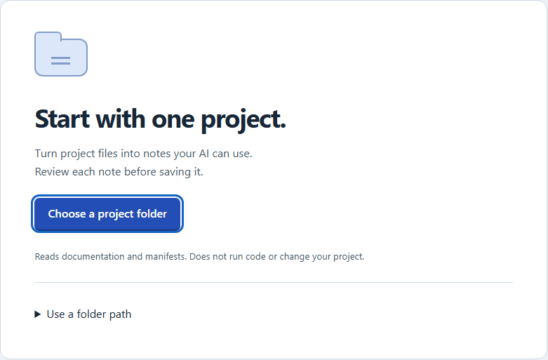
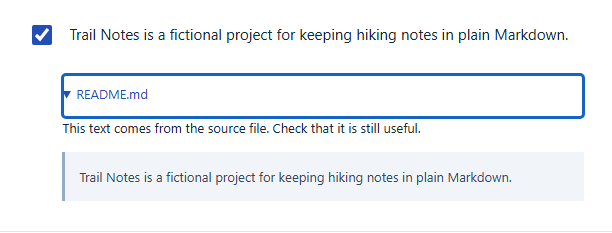
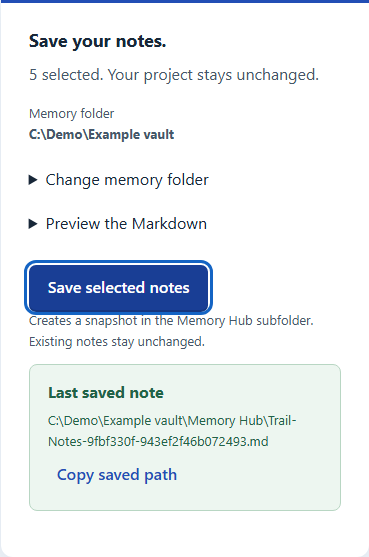
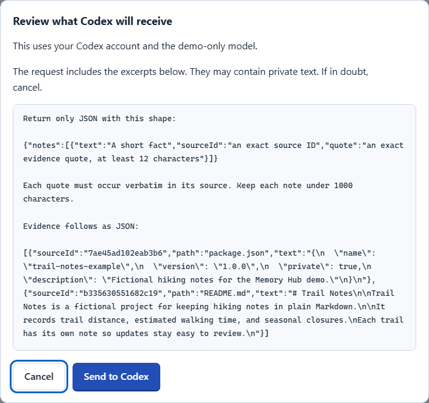

# Save your first project note

Try it with **Trail Notes**, the fictional sample. No account or AI is needed for steps 1–3.

**Open the app.** If you have the Windows ZIP, extract it. Open **Start Memory Hub.cmd** in the extracted **Memory Hub** folder. Keep the launcher window open. No ZIP? Use the [source build steps](../README.md#build-from-source).

## 1. Choose a folder

Select **Choose a project folder**. Pick **Trail Notes** inside the **examples** folder.

## 2. Review one note

Open **README.md** below a note to check its source. Clear the checkboxes for notes you do not want to save.

## 3. Save as Markdown

Select **Save selected notes**. Under **Last saved note**, select **Copy saved path** to find the Markdown file.

**Use Obsidian?** Before you save, open **Change memory folder**. Choose your vault. The app creates a **Memory Hub** subfolder and leaves existing notes alone.

## Optional: review what AI receives

Select **Check for Codex**. If your build is supported, choose a model and select **Use this AI**. Select **Draft notes with Codex** to see the request. Review the excerpts. Select **Cancel** if any text should stay private. **Send to Codex** shares the displayed request with your provider.

This screenshot uses a demo connection. It does not show a supported model name. The app uses your own account and does not update your assistant's native memory. See [AI setup and limits](../README.md#optional-ai-drafting).

All screenshots use the fictional sample and example folder paths. The outlines show where to click.
